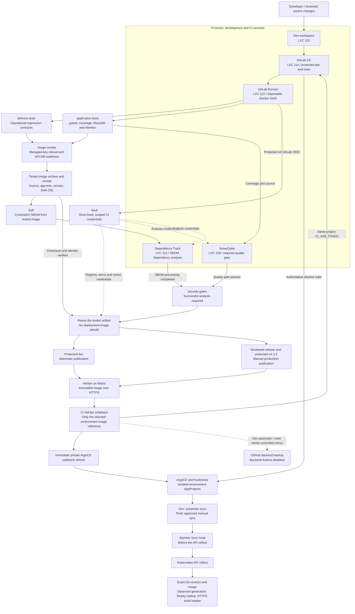
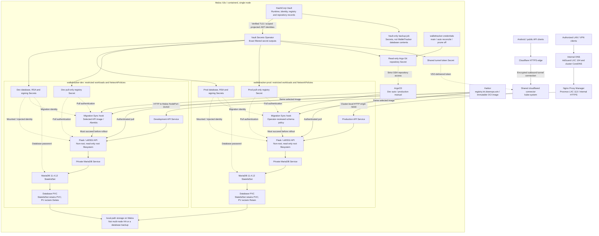
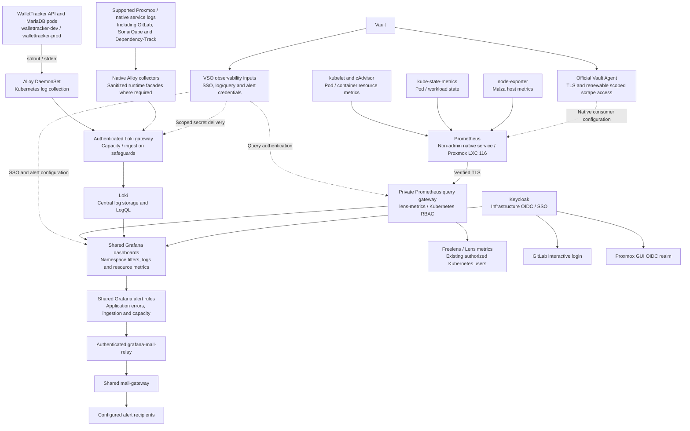
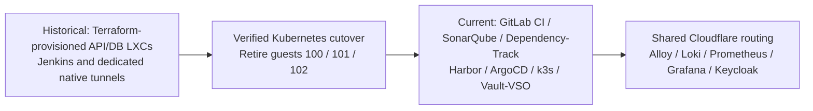

# WalletTracker Backend

WalletTracker's Python API, database migrations and Kubernetes delivery configuration.
The Android client lives in [WalletTracker](https://github.com/noelnovo/WalletTracker);
this repository owns the backend, not APK signing or mobile releases.

**DevOps case study:** a self-managed delivery platform combining Proxmox, GitLab CI,
Docker/DinD build isolation, SonarQube, Dependency-Track, Harbor, k3s/containerd,
Kustomize/ArgoCD, Vault/VSO, Cloudflare Tunnel, NPM, Keycloak and shared
Alloy/Loki/Prometheus/Grafana observability. The diagrams below separate delivery,
runtime traffic/secrets and operational visibility so the integrations are explicit
without hiding everything inside a generic “security” or “Kubernetes” box.

## Architecture

The API and its databases run in **Kubernetes on Malza**. Proxmox hosts the supporting
development, CI and administration services—not the former native API/database guests.
GitLab CI builds and validates the application; **ArgoCD applies the desired state from
Git**. CI does not deploy through a kubeconfig or directly restart Kubernetes pods.

### 1. CI/CD and software supply chain



**SonarQube and Dependency-Track are actual integrations, not placeholder boxes.**
`devops/ci/security_scan.py` submits the Syft-generated SBOM to Dependency-Track,
waits for processing and runs SonarQube with quality-gate waiting enabled. Publication
depends on that job succeeding. The diagram does not claim an additional Trivy job or
an unimplemented blanket CVSS threshold. Merge requests run credential-free test/image
checks; trusted protected refs perform the privileged analysis/publication steps.

The arrows above show CI stage order: **CI** writes Git and sends the Argo webhook.
Harbor itself is not a registry polling deployer, and CI has no cluster-admin kubeconfig.

Each environment has its own API Deployment, MariaDB StatefulSet, persistent database
volume, runtime identity and Kubernetes namespace. Dev is not a copy of production's
financial data, and its database/signing/RSA credentials are separate.

### 2. Runtime, networking, identity material and persistence



Solid arrows describe delivery, traffic or data access; dotted arrows describe
credential material or backup mirroring. Dev and production identities are distinct.
The migration jobs also pull the selected application image using their environment's
pull credential. No database/RSA/signing secret is baked into the image or stored in Git.

### Platform responsibilities

| Component | Location | Responsibility |
|---|---|---|
| k3s / containerd | Malza, `10.2.0.100` | Runs the API, MariaDB, ArgoCD, Vault, VSO and the shared tunnel connector |
| Development workspace | Proxmox LXC 110 | Backend clone at `/home/dev/wallet-backend`; local checks and development |
| GitLab CE | Proxmox LXC 114 | Authoritative backend source, protected branches and CI pipelines |
| GitLab Runner | Proxmox LXC 115 | Existing Docker executor / disposable DinD jobs for tests, image smoke and publication |
| Nginx Proxy Manager | Proxmox LXC 113 | HTTPS reverse proxy for internal service names, including the dev API |
| SonarQube | Proxmox LXC 109 | Source analysis and quality gate |
| Dependency-Track | Proxmox LXC 112 | Software bill of materials and dependency analysis |
| Harbor | Malza | Stores the backend's immutable OCI images |
| Vault + VSO | Malza's Kubernetes cluster | Scoped secret storage and automatic Kubernetes secret delivery |
| Cloudflare Tunnel | Shared connector in `kube-system` | Outbound tunnel connecting Cloudflare's edge to the production Service |
| AdGuard / CoreDNS | Proxmox LXC 104 / `kube-system` | Internal DNS and Kubernetes Service discovery |
| Alloy / Loki / Grafana | Shared `logging` namespace | Log collection, centralized investigation, shared dashboards and alerting |
| Prometheus | Proxmox LXC 116 | Native, non-admin resource-metric collection with Vault Agent-managed access |
| Kubernetes exporters / query gateway | `monitoring` / `lens-metrics` | kube-state-metrics, node-exporter and private Prometheus access for Grafana/Freelens |
| Keycloak | Shared service on Malza | Infrastructure OIDC/SSO for Proxmox, GitLab and Grafana—not WalletTracker user authentication |
| Mail gateway | Shared `mail-gateway` namespace | Existing Grafana alert delivery through the authenticated mail relay |

Kubernetes uses containerd. Docker/DinD here describes the **existing CI executor**;
it is not the application runtime or a requirement to install Docker on new hosts.

### Integration coverage at a glance

| DevOps concern | Concrete implementation | Where it is represented |
|---|---|---|
| Source control and review | GitLab authority, protected `dev`/`main`, GitHub backup, separate Android ownership | CI diagram and branch policy |
| Test isolation | Operational tests, pytest/coverage, real synthetic MariaDB/Alembic checks, disposable image smoke | CI diagram / `.gitlab/ci.yml` |
| Supply-chain analysis | Tested-image Syft/CycloneDX SBOM → Dependency-Track; source/coverage → SonarQube quality gate | Explicit CI diagram nodes / `devops/ci/security_scan.py` |
| Artifact provenance | Version/source/app-tree receipt, archive SHA-256 and image identity checks | CI artifact and publication nodes |
| Registry and promotion | HTTPS Harbor, immutable tags, reuse of tested artifact, protected/manual production release | CI diagram / `devops/ci/publish.py` |
| GitOps | Environment-only writeback, immediate webhook, Kustomize, Argo AppProjects and migration hooks | CI and runtime diagrams / `k8s`, `argocd`, `bootstrap` |
| Secrets and authorization | GitLab OIDC for CI; scoped Vault/VSO delivery; separate runtime, pull and Git credentials | Both delivery/runtime Vault flows |
| Traffic, discovery and TLS | Cloudflare Tunnel, private production Service, NPM dev NodePort, AdGuard/CoreDNS | Runtime diagram and networking section |
| Persistence and migrations | Separate MariaDB StatefulSets/PVCs, Alembic, retention policy and recovery limits | Runtime diagram / database policy |
| Operations and access | Alloy/Loki logs, Prometheus resource metrics, shared Grafana dashboards/alerts, Keycloak infrastructure SSO | Observability diagram below |

Shared platform services are existing estate infrastructure, maintained separately
from this application's CI/manifests. Their presence is not a claim that this repository
installs every operator, identity provider, registry or monitoring service.

## Source ownership and branches

| Project | Authoritative source and pipelines | Backup |
|---|---|---|
| Backend | GitLab `downops/wallet-tracker-backend` | GitHub `noelnovo/WalletTrackerBackend`; backend Actions disabled |
| Android | GitHub `noelnovo/WalletTracker`; GitHub Actions, signing and releases | GitLab `downops/wallet-tracker-android`; GitLab CI disabled |

Corresponding `dev` and `main` branches are kept identical between each project's two
hosting services. Backend and Android are separate codebases; they are not copies of
one another. Long-lived branches are protected and must not be deleted during a merge.

| Backend branch | Namespace | Argo source path | Deployment policy |
|---|---|---|---|
| `dev` | `wallettracker-dev` | `k8s/dev` | Automatic after successful tests, security gates and image publication |
| `main` | `wallettracker-prod` | `k8s/prod` | Protected release source; production publication and Argo sync remain manual |

The separate `wallettracker-credentials` Argo Application tracks `main` at
`k8s/credentials`, automatically reconciling the repository credential declarations
without automatic pruning. This is **not** automatic production application deployment.

### Development delivery

1. Push reviewed integration changes to `dev`.
2. CI runs operational contract tests, application tests and real MariaDB migration tests.
3. CI builds an image and checks startup, managed-key refusal and API/database readiness
   against disposable synthetic databases.
4. Dependency-Track processes the SBOM and SonarQube must pass its quality gate.
5. CI verifies and publishes the **same tested image artifact**, rather than rebuilding
   a different image for deployment.
6. CI updates only `k8s/dev/kustomization.yaml` through the same-project `CI_JOB_TOKEN`.
7. CI immediately refreshes ArgoCD through its private webhook and mirrors the GitOps
   revision to GitHub. ArgoCD's automated dev sync performs the rollout.
8. CI verifies the exact Git revision, deployed image, observed generation, Ready
   replica and HTTPS readiness/build revision.

Dev delivery continues while a `dev` → `main` release MR is open. Generated GitOps
commits are excluded from recursive builds; stale pipelines cannot overwrite newer
source. A registry push or an Argo webhook HTTP success alone is not deployment proof.

### Production releases

`VERSION` is the backend delivery version. Dev tags use
`dev-<version>-<source-sha>`; production tags use the plain semantic version. Images are
stored at `downops/wallettracker/backend`, published through `registry.downops.win`
and pulled through `registry.int.downops.win` over verified HTTPS.

Production requires a reviewed `dev` → `main` release, a matching protected `vX.Y.Z`
tag, the manual production publication job and an approved **manual ArgoCD sync**.
The publisher checks the version/tag, source ancestry, tested artifact and mirror
state. Routine pushes to `main` do not publish or roll out production. Existing
protected GitHub `main` mirroring remains an owner-controlled operation.

Source and deployed versions can legitimately differ. For example, the verified
2026-11-08 snapshot has source `VERSION=2.1.0`, dev on a `dev-2.1.0-*` image and production
still on the approved **2.0.0 digest**. CI/layout/documentation maintenance is not a
production release.

## Networking and Cloudflare

### Public production API

```text
https://api.downops.win
  → Cloudflare HTTPS edge
  → shared k3s cloudflared tunnel
  → http://wallettracker-api.wallettracker-prod.svc.cluster.local:5000
  → production API pods
  → production MariaDB Service
```

The currently verified shared tunnel is `k3s-cluster-rotated-20261006`. Its connector
runs in `kube-system` and obtains its tunnel token through VSO. The tunnel is shared
infrastructure, not a new dedicated WalletTracker connector for each release.

Cloudflare handles public HTTPS; the connector maintains an outbound encrypted tunnel.
The HTTP origin above is a private Kubernetes Service, **not a public HTTP endpoint**.
Production traffic does not need to traverse NPM or the production NodePort, and an
application deployment does not open a new inbound WAN port.

### Internal development API

```text
https://wallettracker-dev.int.downops.win
  → NPM on Proxmox LXC 113
  → http://10.2.0.100:31410
  → wallettracker-api Service in wallettracker-dev
  → development API pods
```

Dev access remains internal and subject to the existing LAN/VPN/firewall rules.
Production's Service also exposes NodePort `31411`, but the public tunnel uses its
cluster-local Service endpoint directly. Neither MariaDB Service is publicly exposed.

## Observability, alerting and infrastructure access

### 3. Shared operational visibility and SSO



WalletTracker uses the **existing shared Kubernetes dashboards**, not a dedicated
WalletTracker-only dashboard. In Grafana, select `wallettracker-dev` or
`wallettracker-prod` in **Estado y errores** (`/d/downops-overview`) or
**Investigar registros** (`/d/kubernetes-logs`), under the internal
`https://logs.int.downops.win` service.

The live review confirmed WalletTracker log aggregation in Loki and running-pod
metrics through the private Prometheus gateway. These are **infrastructure/resource
metrics and log observations**, not financial KPIs, request-rate measurements or
instrumented HTTP latency/tracing. Log rate must not be presented as HTTP request rate.
No dedicated dashboard, exporter or new application instrumentation was added here.

Keycloak's Proxmox/GitLab/Grafana SSO is separate from the backend's application-user
authentication and from GitLab's job OIDC tokens issued to Vault. ArgoCD currently
uses its local/project-token authentication; no Argo OIDC/Dex configuration was found
in this snapshot. The diagram deliberately does **not** imply Keycloak protects every
service or that WalletTracker users authenticate through infrastructure SSO.

Shared Grafana alert configuration routes notifications through the mail relay and
mail gateway. This is existing platform alerting, not a claim that this backend sends
business emails or that a new alert-delivery test was performed during this README review.

## Databases, secrets and operational boundaries

- **MariaDB 11.4.12** runs as one StatefulSet per environment. The main account/session
  database is `wallet_tracker`; tenant databases use `wallet_tracker_u*`.
- **Alembic** versions the main and tenant schemas. Argo's migration Sync hook uses the
  selected application image before the API rollout. Existing unversioned schemas are
  not silently stamped, and a failed migration blocks deployment.
- Production schema/activation approvals in `devops/config/environment-state.json`
  are operator-reviewed inputs. CI cannot issue its own approval, reset financial data
  or reinterpret old restore receipts as current recovery evidence.
- **Vault** owns runtime database, RSA/signing, registry and repository credentials.
  Kubernetes receives filtered outputs through VSO; CI uses short-lived scoped GitLab
  OIDC tokens. No credentials, private keys, kubeconfig or administrative PAT belong
  in this repository, image or README.
- The API runs non-root with a read-only root filesystem, managed key mounts and
  readiness/liveness probes. NetworkPolicies isolate database access and environments;
  application logs go to stdout/stderr.
- Production registration is disabled by default **on the server**. A backend deploy
  must not silently enable it; the Android registration UI remains available for
  separately authorized registration windows.

### Persistence and recovery limitations

This is currently a **single-node k3s cluster with local-path storage**, not a highly
available database platform. A pod restart is different from node or disk loss.

Both MariaDB StatefulSets retain their PVCs when scaled down or deleted. At the verified
2026-11-08 snapshot, the production database PV has reclaim policy **Retain**, while
the dev PV has **Delete**. StatefulSet PVC retention does not make manual PVC deletion
safe, particularly in dev.

There is deliberately **no scheduled WalletTracker database backup in Kubernetes**.
The estate's Kubernetes backup policy is Vault-only; Vault backups protect secrets,
not WalletTracker accounts, transactions or tenant databases. Before risky database
operations, obtain an explicitly approved, consistent recovery plan. Do not recreate
removed backup schedules or assume historical WalletTracker recovery archives still
exist.

## Repository layout

```text
.gitlab/ci.yml              Full backend GitLab pipeline definition
.gitlab-ci.yml              Minimal GitLab discovery include
VERSION                     Delivery semantic version
app/                        Flask API, runtime image and Alembic migrations
tests/                      Application regression tests
k8s/dev/                    Development desired state and immutable image reference
k8s/prod/                   Production desired state and immutable image reference
k8s/credentials/            VSO-managed Argo repository credential declarations
argocd/                     Environment and credential Application declarations
bootstrap/                  Operator-owned namespaces and isolated AppProjects
devops/ci/                  Image checks, packaging, security and GitOps publication
devops/kubernetes/          Deterministic manifest generator
devops/database/            Migration gates and synthetic database checks
devops/database/sql/        Explicit operator SQL; never automatic approval
devops/vault/               Scoped credential contract and read-only bootstrap plan
devops/tests/               Operational regression tests
devops/config/              Current delivery and environment policy
devops/records/             Historical, non-secret migration/audit receipts
bruno/                      API request collections
```

`devops/records` is historical evidence, **not the active deployment runbook**. Current
policy is in the CI definition, Argo/Kubernetes declarations and `devops/config`.
The old AI handoff Markdown documents are intentionally absent; this README is the
human-facing infrastructure overview.

## Local checks

Use Python 3.12+ and `uv`; keep virtual environments inside the repository. Application
tests use isolated fixtures, while the CI MariaDB/image checks create disposable
synthetic databases. Do not point those checks at a live dev or production database.

```sh
cd app
uv sync --frozen
uv lock --check
cd ..

ENABLE_REGISTER=true PYTHONPATH="$PWD/app" app/.venv/bin/pytest tests -q
python3 -m unittest discover -s devops/tests -p 'test_*.py'
python3 -m devops.kubernetes.render_manifests --check
```

The registration override above applies only to that test process. Running the real
API requires an authorized, automatically injected **development** identity; do not
copy production secrets or generate replacement production keys to make it start.

## What happened to Terraform and Jenkins?

The earlier architecture used Terraform to provision native Proxmox API/database
guests, Jenkins for delivery, and dedicated native tunnel processes. That is
**historical infrastructure**, not the current deployment path.

Jenkins LXC **100**, native API LXC **101** and native database LXC **102** were retired
after the Kubernetes cutover. Their Terraform/Jenkins deployment files and dedicated
connectors were removed. They are not running and must not be recreated by replaying
an old `terraform apply` or restoring a legacy writer against current financial data.

Proxmox still matters because it hosts the supporting services listed above. However,
this repository no longer provisions Proxmox guests or applies Terraform during CI:
application delivery is now **GitLab CI → Harbor → GitOps → ArgoCD → Kubernetes**.


