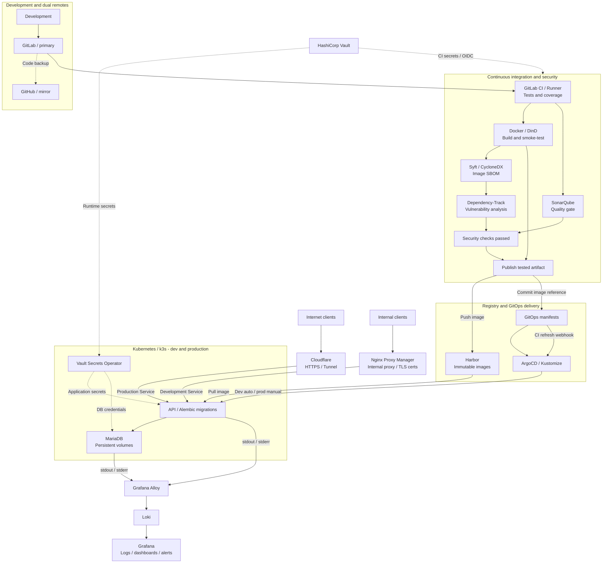

# WalletTracker Backend

The Python API behind [WalletTracker](https://github.com/noelnovo/WalletTracker),
with database migrations and a complete container-based delivery workflow.

This project connects development, automated testing, software supply-chain analysis,
GitOps deployment, secret management and centralized logging. The overview below
focuses on how the technologies work together, rather than where they are hosted.

## End-to-end architecture



### Technologies and responsibilities

| Area | Technology | Role in the workflow |
|---|---|---|
| Development | Python, Flask, pytest, Alembic | Implement the API, test its behavior and version database schema changes. The Android client is maintained separately. |
| Source availability | GitLab + GitHub dual remotes | GitLab is the authoritative backend source and CI platform; GitHub holds a synchronized code backup. This preserves a second copy, not automatic CI or deployment failover. Backend GitHub Actions are disabled to avoid duplicate pipelines. |
| Continuous integration | GitLab CI / Runner | Run operational contracts, application tests, coverage and real migration checks against disposable databases before an image can be published. Merge requests use credential-free checks; trusted protected refs run the privileged security and publication steps. |
| Image validation | Docker / DinD, OCI artifacts | Build and smoke-test the container, then bind it to its source revision, version and SHA-256 receipt. Publication reuses the tested artifact instead of rebuilding it. Docker is the CI build tool; Kubernetes runs the image through containerd. |
| Code quality | SonarQube | Analyze source and coverage, report maintainability and security findings, and require a successful quality gate before publication. |
| Dependency security | Syft, CycloneDX, Dependency-Track | Generate a software bill of materials (SBOM) from the tested image and submit it for dependency and vulnerability analysis. CI waits for processing; this is distinct from SonarQube's source-quality gate. |
| Image registry | Harbor | Store versioned, immutable OCI images over HTTPS. Scoped push and pull identities separate CI publication from workload image access. |
| Desired state | Git, Kustomize | Keep Kubernetes configuration and each environment's image reference under version control. After publication, CI writes the selected reference to Git and immediately refreshes ArgoCD through its webhook. |
| Continuous delivery | ArgoCD | Apply the desired state from Git, run migration hooks and reconcile Kubernetes resources. Development syncs automatically; production requires an approved release and manual sync. CI does not deploy using a cluster-admin kubeconfig. |
| Application runtime | Kubernetes / k3s, containerd | Run isolated development and production workloads with Services, non-root containers, read-only API filesystems, health probes and NetworkPolicies. CI verifies the exact dev revision, image and readiness after rollout. |
| Database | MariaDB, Alembic, persistent volumes | Keep each environment's data separate and persistent across pod replacement. Version main and tenant schemas; a failed migration blocks rollout. Persistence alone is not a backup or high availability. |
| Secrets | HashiCorp Vault, Vault Secrets Operator (VSO) | Store scoped credentials centrally. CI uses short-lived GitLab OIDC access; VSO delivers filtered Kubernetes Secrets for applications, databases, registry pulls and repository access. Private keys and passwords stay out of Git and images. |
| Internal HTTPS | Nginx Proxy Manager | Manage TLS certificates and reverse-proxy internal service names, including the development API. Internal routing is separate from the public production tunnel. |
| Internet exposure | Cloudflare, Cloudflare Tunnel | Terminate public HTTPS and route requests through an outbound encrypted connector to the production Kubernetes Service, without opening a new inbound WAN port. Databases and development are not publicly exposed. |
| Log collection | Grafana Alloy | Collect API and database stdout/stderr with Kubernetes context and forward logs to centralized storage. |
| Log storage | Loki | Store and query aggregated logs using labels and LogQL, enabling investigation across workloads and environments. |
| Operational visibility | Grafana | Explore Loki logs through shared dashboards and existing alert rules. This documents log-based visibility, not custom business analytics or distributed tracing. |

Solid arrows show delivery, traffic or log flow; dotted arrows show code backup or
credential delivery. Registry-pull and shared tunnel credentials are also delivered
through VSO; their individual edges are omitted to keep the overview readable.
Shared services have their own lifecycle—this repository does not install the whole platform.

## Delivery policy

- **Development:** reviewed changes land on protected `dev`; successful tests,
  security checks and image publication lead to GitOps writeback, an immediate
  ArgoCD refresh and an automatically verified rollout. Image tags include the
  version and source revision.
- **Production:** a reviewed `dev` → `main` release and matching protected `vX.Y.Z`
  tag precede manual image publication and an approved manual ArgoCD sync.
  Routine source or documentation updates are not production releases.
- **Source backup:** corresponding branches are synchronized across GitLab and
  GitHub. A second remote protects source availability, not database contents.
- **Data safety:** dev checks use synthetic data, never production finances.
  Persistent volumes are not a recovery plan, and there is no scheduled
  WalletTracker database backup in Kubernetes. Vault backups protect secrets,
  not application data; risky database work needs an explicitly approved recovery plan.

## Repository guide

| Path | Contents |
|---|---|
| `app/`, `tests/` | Flask API, runtime image, Alembic migrations and application regression tests |
| `.gitlab/ci.yml` | Backend pipeline; the root `.gitlab-ci.yml` includes it |
| `devops/ci/`, `devops/tests/` | Image validation, security integration, publication and operational regression tests |
| `k8s/`, `argocd/`, `bootstrap/` | Environment manifests, VSO declarations, Argo Applications and operator-owned bootstrap resources |
| `devops/database/`, `devops/kubernetes/`, `devops/vault/` | Migration safeguards, manifest generation and scoped credential contracts |
| `devops/config/`, `VERSION` | Current environment policy and delivery version |
| `devops/records/` | Historical migration/audit evidence, not the active deployment runbook |
| `bruno/` | API request collections |

## Local checks

Use Python 3.12+ and `uv`, with virtual environments inside the repository.

```sh
cd app
uv sync --frozen
uv lock --check
cd ..

ENABLE_REGISTER=true PYTHONPATH="$PWD/app" app/.venv/bin/pytest tests -q
python3 -m unittest discover -s devops/tests -p 'test_*.py'
python3 -m devops.kubernetes.render_manifests --check
```

The registration override applies only to the test process. Running the API itself
requires an authorized, automatically injected development identity; do not copy
production secrets or point synthetic migration/image tests at live databases.
